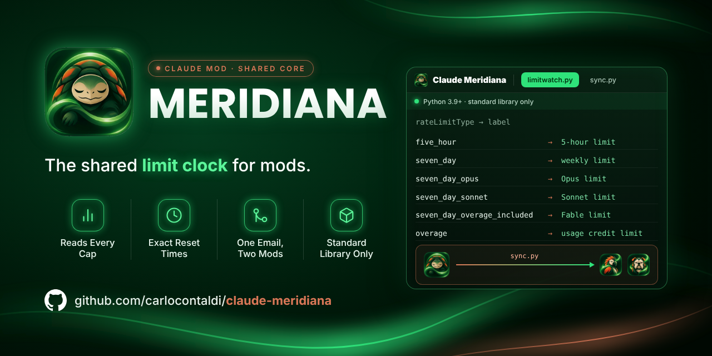

<h1 align="center">
  <br>
  Claude Meridiana
</h1>

> **me·ri·dia·na** · Italian /me.riˈdja.na/ (*meh-ree-DYAH-nah*) · *noun*, feminine, plural *meridiane*
>
> A sundial: a dial on which the shadow of a rod, the gnomon, shows the hour.

<br>

A sundial reads the hour from a shadow. Claude Meridiana reads a Claude Code usage-limit error and works out when each cap resets. It is the code that [Claude Portavoce](https://github.com/carlocontaldi/claude-portavoce) and [Claude Goon](https://github.com/carlocontaldi/claude-goon) share: which caps the error reports and when each comes back, a file-lock claim so one watcher runs per reset time, and the ntfy push.

<p1 align="center">
  <br>
</p1>

Python 3.9+, standard library only. Works on Linux, macOS, and Windows (uses `fcntl.flock` on POSIX and `msvcrt.locking` on Windows; CI gates on Linux only, its Windows leg is informational; on Windows two probes of a lock made at the same moment can each read the other as its holder, because Windows has no shared lock). Python on Windows has no time zone database: there, `pip install tzdata`; without it a reset stated in a named zone is not understood. It is not a package or a plugin: a plugin is cloned on its own and cannot import from another repository, so `sync.py` copies `limitwatch.py` into each plugin's `hooks/` with a hash header, and each plugin's tests fail if its copy no longer matches that header.

```
python3 sync.py           # copy into ../claude-portavoce/hooks and ../claude-goon/hooks
python3 sync.py --check   # exit 1 if a copy differs from limitwatch.py
python3 -m unittest discover -s tests
```

## Caps it knows

Read from the error row's `quotaLimits` / `apiErrorParams.rate_limit_info`, else from the message text.

| `rateLimitType` | Label |
|---|---|
| `five_hour` | 5-hour limit |
| `seven_day` | weekly limit |
| `seven_day_opus` / `seven_day_sonnet` | Opus limit / Sonnet limit |
| `seven_day_overage_included` | Fable limit |
| `overage` | usage credit limit |

A spend cap that blocks the usage credits is reported beside the limit the error names, with the reset from `overageResetsAt`: `overageDisabledReason` `org_spend_cap_reached` is a spend limit, `org_level_disabled_until` the monthly one. Claude Code's error does not say whether a spend cap is daily, weekly or monthly, so the period is inferred, in this order:

1. the error's own flags: `dailyCapPaused` is daily, a full `overagePeriodMonthly` is monthly;
2. a reset more than a week away, at the turn of a month (00:00 UTC on the 1st), or at a day of the month and UTC time already seen for a monthly cap, is monthly;
3. a reset between one day and a week away is weekly;
4. a reset within a day could be a daily or a weekly cap, so it stays "individual spend limit".

Rules 2 and 3 assume a monthly cap resets at the turn of the calendar month, unless it was seen resetting at another moment. Each such moment (day, hour and minute, UTC) is kept in `monthly_anchors.json` (written under `monthly_anchors.lock`) beside the `handover/` folder, the last four of them; a moment on the 29th to the 31st does not come back in a short month. These kinds only limit the credits, so a plugin can tell that the plan itself is usable once its window resets.

The spend-cap and Fable rows come from Claude Code 2.1.322's own tables, not from a real error: every limit row seen so far is a 5-hour or weekly one.

## One email for both plugins

Portavoce and Goon both email when a limit resets, and the free ntfy tier allows five emails a day. When both are installed with the same address, they try to send one email, from Goon. The protocol lives here so that both run the same code; the hash check in each plugin's tests keeps the copies in step. Each plugin works alone when the other is absent or older.

All hand-over files are in `<claude folder>/meridiana/handover/` (the folder follows `CLAUDE_CONFIG_DIR`; `MERIDIANA_DIR` overrides it) and are named by the planned time.

| File | Written by | Holds |
|---|---|---|
| `.offer` | Goon, locked while its watcher lives | the resume time and a fingerprint of the email address |
| `.intent` | Portavoce, locked while its watcher waits | its push time and the same fingerprint |
| `.note` | Portavoce | the caps that reset and the caps still in force |
| `.verdict` | whichever side decides first | `goon` or `portavoce` |
| `.sent` | Goon | that its email went out, with the time and fingerprint |

An offer and an intent match when the fingerprints are equal and the times are at most `MERGE_WINDOW` (5 seconds) apart.

1. Goon opens an offer when its watcher starts, but only if an email address and token are set. Portavoce opens an intent when its watcher starts to wait.
2. At its resume time Goon, if it is switched on and has sessions waiting, writes the verdict `goon` before it resumes any of them. It then resumes them 15 seconds apart.
3. At its push time Portavoce looks for a live matching offer. With none it sends its own email. With one it writes the note and acts on the verdict:
   - **Verdict `goon`:** Portavoce pushes to the phone at once, without the email header, then waits for Goon's watcher to end (up to 2 hours). If Goon wrote the sent mark, Portavoce sends nothing more. If Goon ended without sending, Portavoce sends its own email, so the phone gets a second push.
   - **No verdict and Goon's watcher has ended** (Goon was off or had no sessions): Portavoce sends its own email.
   - **No verdict after 10 minutes:** Portavoce writes the verdict `portavoce` and sends its own email. Goon's later claim fails, so Goon pushes without an email.
4. When Goon has resumed its sessions and has something to report, it reads the note. It waits for the note (up to 2 minutes) only while a matching intent is held, that is, while a Portavoce is known to be coming. It sends one email that starts with Portavoce's announcement and goes on with Goon's summary, then writes the sent mark. With nothing to report it sends nothing, and Portavoce sends its own.
5. A Portavoce that wakes after Goon's watcher has ended finds no offer, reads the sent marks, and if one matches only pushes to the phone.

One verdict file, made in one atomic step, decides who emails, so the two never both send the email for the same reset. This holds whatever the order or timing, with these exceptions:

- If Goon is killed after its push went through and before it wrote the sent mark, Portavoce sends its own email as well.
- If the shared folder cannot be used (a read-only disk, a filesystem without hard links), each plugin logs `no hand-over` and sends its own email.
- Emails planned more than `MERGE_WINDOW` apart are separate events and stay separate.

What it costs:

- When Goon claims and then sends nothing (every session had already continued), Portavoce's phone is pushed twice.
- If Goon's note wait runs out before a Portavoce that is still asleep leaves its note, Goon's email lacks the announcement. Portavoce then sends no email, and its phone push carries the announcement.
- If Goon takes more than 2 hours to finish after it claimed, Portavoce stops waiting and leaves the email to it; if Goon then fails, no email goes out.

The verdict, note and sent mark stay after Goon's watcher ends, because Portavoce may still be reading them. Goon removes any older than a day when it next starts.

## Private ntfy topics

`stored_topic(path, prefix)` makes `<prefix>-` and 22 random letters and digits (131 bits, from `secrets`) on first use, saves it at `path` (mode 600) and returns it from then on; `effective_topic(option, path, prefix)` lets a plugin option win, with an empty option falling back to the saved topic. A plugin's `topic` command shows the name to subscribe the phone app to.

## License

[MIT](LICENSE)
